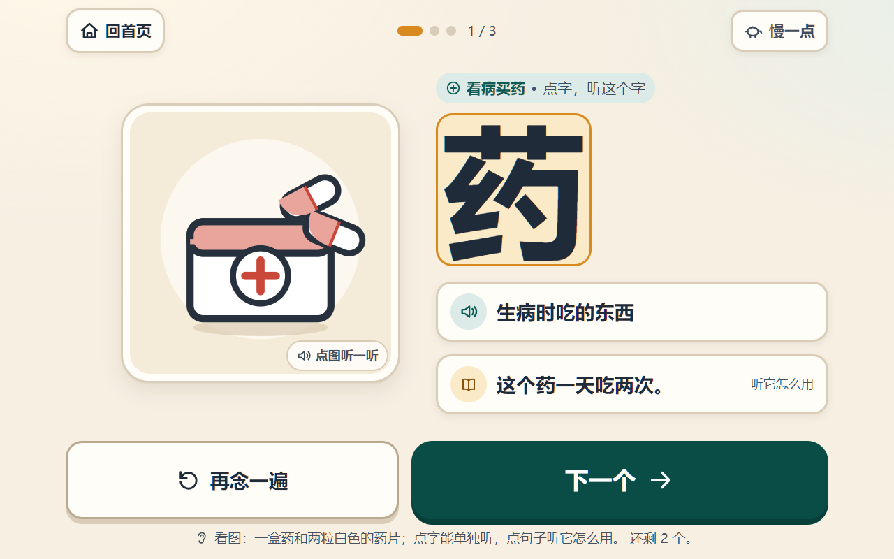
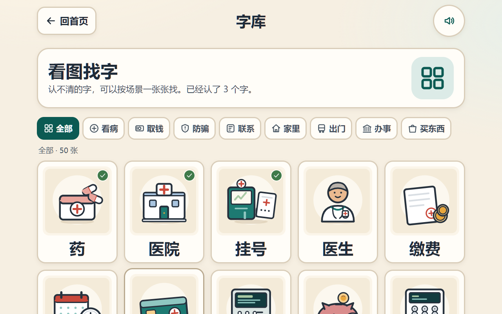
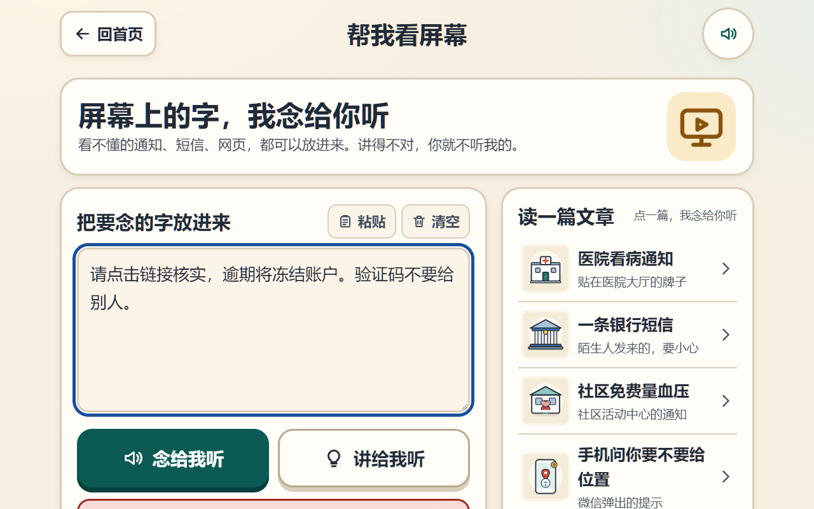

# 字伴 Ziban

> **把查字典简化成“停一下”：老人看得懂屏幕，孩子在探索里认字。**

<p>
  
  <a href="LICENSE"></a>
  <a href="content/LICENSE.md"></a>
  
  
  <a href="https://github.com/ADES-RepkSSS/ziban/actions/workflows/ci.yml"></a>
  <a href="https://ades-repksss.github.io/ziban/"></a>
</p>

字伴是一个**公益、开源、离线优先**的中文识字助手。它不发明一套课程，也不要求先坐下来“学 20 个字”。它只做一件事：**把查字典的繁杂流程，简化成一次停留**——看到不认识的字，鼠标停一下（或点一下），就能听到读音、看到大白话解释和一个生活例句，然后继续做想做的事。

它没有改变学习本身，也不替人学习——**只是简化了查字典的繁杂流程**。

它最初来自家里老人学用电脑、认字的真实需求。我们把代码和内容开源，是希望更多家庭、社区和学校能自己改、自己用，而不是再做一个封闭的识字 App。

**它从老人开始。** 目标用户是 **65–85 岁、识字量 < 500、母语听说完全正常**的老人。他们卡住的往往不是“不会用电脑”，而是屏幕上那行字。字伴先帮他们把眼前这一关过去：**不用打字、不用框选**；桌面版鼠标停在哪，小窗就念哪。“每天三个字”是可选的练习，不是使用前提。

**它也可能属于孩子。** 对于处在识字阶段的孩子，我们想验证另一种学习范式：**不是先学字再使用，而是在使用中遇到字、查一下、继续使用。** 把电脑交给孩子，真正驱动他认字的不是家长催促，而是“我想知道屏幕上这句话是什么意思”的探索欲；字伴只负责把查字典的流程简化到不打断这份探索。我们不做积分、排行榜、打卡，也不把“多认几个字”变成新的任务。

**一句话：需求先于识字。** 人是因为想做成某件事才去认字。字伴不替代那件事，只把门槛降到足够低：老人想用电脑办事，孩子想探索互联网，都是同一件事。

> 这不是“把孩子丢给电脑”的借口：屏幕时间、内容安全仍由家长把关；字伴不替代监护，也不做家长监控。
>
> 当前是 **v0.2.1 桌面取词实验版**（含网页演示）。老人场景已有可运行版本（Windows 桌面取词实测，macOS 待真机）；**儿童场景是方向与假设，不是已验证的产品结论**。内容和能力边界写在 [docs/05](docs/05-experimental-v0.1.md) 与 [docs/08](docs/08-screen-lookup.md) 里，不把没做的功能说成能用。

我们不想做两套割裂的产品：不做“儿童识字 App 的老年皮肤”，也不做面向视障者的完整屏幕阅读器。我们想做的是一层很薄的“查字”能力：**老人用它跨过屏幕上的字，孩子用它追自己想看的内容。**

## 两种使用场景，同一种学习假设

| 谁 | 他想做的事 | 字伴做什么 | 字伴不做什么 |
|---|---|---|---|
| 老人（当前重点） | 用电脑看病、取钱、办事 | 光标取词、朗读、口语解释、风险提醒 | 不替他操作，不催他学习 |
| 识字阶段的孩子（方向） | 探索互联网、看懂感兴趣的内容 | 停一下查字、读音、例句 | 不做课程、积分、排行榜、家长监控 |
| 共同点 | 先有想做的事 | 把查字典的摩擦降到最低 | 不把“识字”变成使用前提 |

## 我们想验证的学习范式

传统识字产品大多假设：**先学字 → 再使用**。

字伴想验证：**先使用 → 遇到字 → 查一下 → 继续使用**。

对老人，这是“别被屏幕挡住”；对孩子，这是“别被查字典打断探索”。

我们不认为“把电脑丢给孩子”本身会教育孩子；真正起作用的是孩子想看懂、想参与、想探索的内驱力。工具只做减法：把查字从“打开网页 / 输入拼音 / 翻结果 / 理解释义”减到“停一下”。如果这个假设成立，识字会成为使用过程的副产品，而不是额外任务。

## 界面

<p align="center">
  
</p>

<p align="center">
  
</p>

<p align="center">
  
  
</p>

<p align="center">
  
</p>

首页按 **“看屏幕 → 每天三个字 → 看图找字 → 帮我看屏幕”** 排列，每项配一张特征图；不识字的人可以按图找入口，不必先读标题。首次打开直接看到工具页，不再强制看完引导；需要教程时点底部“怎么用”。

## 现在能做什么（以老人场景为主）

> 儿童场景目前只有方向，没有上线功能；在真实验证之前，不把它当儿童产品宣传。

### 基础功能（已可用）

| 功能 | 说明 |
|---|---|
| 50 张识字卡 | 看病、取钱、出门、家里、联系、办事、买东西、防骗 8 个场景 |
| 图片配字 | 52 张手绘 SVG；点图片会念图片描述，不把“答案”画成文字 |
| 朗读 | 自动念“词 + 释义”；点单字只念这个字；点释义/例句分别朗读 |
| 云端朗读（可选） | 桌面/网页版都能填 OpenAI 兼容或阿里云百炼 Qwen-TTS 的 API Key；**默认关**，打开后要念的文字才发到用户选的服务，音频不落盘。网页版 Key 存本机 `localStorage`，需服务支持 CORS。见 [docs/12](docs/12-cloud-tts.md) |
| 逐字高亮 | 读词时按字高亮；TTS boundary 不可靠时有字时长兜底 |
| 每天三个字 | 新卡 3 张 + 最多 3 张到期复习；1/3/7/14/30/60 天温和排期 |
| 不指责 | 没有“错误/失败/你错了”；朗读失败只说“这次没念出来，再点一下” |
| 大按钮 | 主要操作 ≥ 88×88，字号大，对比度高，键盘 focus 可见 |
| 本地优先 | 学习记录只在 `localStorage`；无账号、无广告、无内购、无埋点 |

### 附加功能（文本路径可用，原生能力待接）

| 功能 | 现状 |
|---|---|
| 粘贴文字朗读 | ✅ 逐句朗读并高亮；点任意一句只听那句 |
| 离线“讲一讲” | ✅ 词表把验证码、冻结账户、逾期、挂号、窗口等换成口语；没把握就明说“只会念” |
| 风险提示 | ✅ “转账 + 链接 + 冻结账户”“验证码给别人”等组合提醒；剂量描述提醒问医生 |
| 示例文章 | ✅ 医院流程、银行诈骗短信、社区免费量血压、微信位置权限；每句有人工解释 |
| 光标跟随取词 | 🟡 电脑版（0.2）：鼠标停在哪就查哪，**按整词取**（词表 + 中文分词，不拆成单字）；截图区域随分辨率/缩放自适应。Windows 已实测，macOS 待真机。浏览器版仍用粘贴文字 |
| 任意网址正文抽取 | ⏳ 需要扩展/桌面壳；当前用自带文章 + 粘贴文本验证交互 |
| 版本提示 | 🟡 桌面版启动后自动检查 GitHub；有新版本只提示并给链接，不自动下载/安装；可在“设置 → 版本”关闭 |
| 跟读/发音评分 | ⏳ v0.1 不做自动评分，避免方言被误判 |

## 快速开始

要求：Node.js 20+（桌面版建议 22.12+，Electron 40 的要求）、pnpm 11。

```bash
git clone https://github.com/ADES-RepkSSS/ziban.git
cd ziban
pnpm install
pnpm dev
# 打开 http://127.0.0.1:4173
```

验证：

```bash
pnpm check      # 内容门禁 + strict 类型 + 67 个测试 + 生产构建
pnpm screenshot # 可选：用本机 Edge/Chrome 跑关键路径并生成截图
```

桌面版（Windows 已实测；macOS 需要 Xcode 命令行工具，见 [docs/08](docs/08-screen-lookup.md)）：

```bash
pnpm install --frozen-lockfile
pnpm desktop:build
pnpm desktop:start
# 首页 → “开始看屏幕” → 鼠标停在字上
```

> 第一次 `pnpm install` 需要下载依赖（包括 Electron）；如果网络慢，不是代码卡死。

## 部署与使用

| 目标 | 怎么做 |
|---|---|
| 网页版本地开发 | `pnpm dev` → <http://127.0.0.1:4173> |
| 网页版发布到 GitHub Pages | push `main`，`Deploy web demo to GitHub Pages` 自动构建 `apps/web/dist`；Pages Source 选 GitHub Actions |
| 网页版发布到其他静态托管 | `pnpm build`，把 `apps/web/dist` 整个目录上传即可（hash 路由，无需重写规则） |
| Windows 桌面版 | `pnpm desktop:build` → `pnpm desktop:start` |
| Windows 绿色版 | `pnpm desktop:package` → `release/ziban-win32-x64/Ziban.exe`（免安装；未签名） |
| macOS 桌面版 | 安装 Xcode Command Line Tools；`pnpm desktop:build` → `pnpm desktop:start`；允许“屏幕录制”；macOS 包需在 Mac 上打 |

完整的部署步骤、首页工具说明、老人使用流程、macOS 权限、数据目录和排错见
**[docs/09-deploy-and-use.md](docs/09-deploy-and-use.md)**。

> **在线演示是网页版，没有屏幕取词功能**：它不能读取其他软件，只能粘贴文字。
> 光标取词请用 Windows/macOS 桌面版；Windows 已有免安装绿色版。

> 当前桌面版还没有 DMG/NSIS 安装包；不要把它说成“下载即用”。

## 技术结构

```text
apps/web/                 React + Vite + TypeScript，产品本体
  src/app/                路由、学习进度、语音队列
  src/capabilities/       语音适配器、Explainer、OCR/网页/ASR 契约
  src/components/         大按钮、图卡、字、页头、图标
  src/features/           welcome / home / learn / library / card / helper / reader / settings
  src/content/            cards.generated.json（构建产物）
  src/data/articles.ts    自带文章 + 人工解释
apps/desktop/             Electron 壳：光标跟随取词、WinRT/Vision OCR、小窗、可选大模型
packages/core/            纯函数：类型、间隔调度、文本时间轴、口语词表、屏幕取词
content/                  50 张卡片 YAML、52 张 SVG、字表
scripts/                  内容构建/校验/截图/桌面构建与冒烟
docs/                     立项、内容流水线、合规、Electron、路线图、实验版说明、屏幕取词、部署与使用
```

设计纪律：

- **平台判断只在能力层。** UI 不直接碰系统 API；将来换 sherpa-onnx、系统 OCR、AX，不改学习卡。
- **UI 与桌面能力解耦。** hash 路由 + 相对资源，Electron 用自定义协议加载即可。
- **生产无内联脚本/样式。** 方便严格 CSP；默认不联网。唯一默认请求是 GitHub 版本检查（可在设置关闭），只读公共版本信息。
- **失败不指责。** 所有文案遵守三原则。

能力契约见 [apps/web/src/capabilities/contracts.ts](apps/web/src/capabilities/contracts.ts)。

## 内容状态（重要）

- 50 张卡片全部是 **`status: draft`**；
- 释义/例句是项目组按日常口语手写的原型（`dict: self`, `corpus: self`），**没有冒充词典或真实语料**；
- 配图是手绘 SVG（CC BY-SA 4.0），**不是文生图**；
- 拼音仅作内部数据与家人参考，**不用于教学**；
- **没有经过 C5 对抗审校与人工审校，禁止直接对外发布。**

屏幕语料第一批 **293 条**（医院/银行/政务/手机/出行/防骗/购物 7 个文件）也全部是
**机器审校草稿，未人工审校、未做老人测试**；`source=auto-*`，小窗会显示“机器审校 · 不一定对”。
它不会自动装进程序；要显式安装：

```bash
pnpm corpus:install
```

这批语料**不需要新画 SVG**：屏幕小窗没有插图，语料 schema 也没有 `image` 字段；
现有 50 张卡 + 52 张 SVG 仍完整。以后新增字卡才需要一卡一图。

内容流程与加卡方式见 [content/README.md](content/README.md)；AI 流水线约束见 [docs/01-ai-content-pipeline.md](docs/01-ai-content-pipeline.md)。
语料格式、批量生成提示词、验收清单见 [docs/10-corpus-handoff.md](docs/10-corpus-handoff.md)，
第一批复盘见 [docs/11-corpus-batch1-handoff.md](docs/11-corpus-batch1-handoff.md)。

## 路线图

| 版本 | 目标 |
|---|---|
| v0.1（当前） | Web 识字卡 + 粘贴文字朗读/解释 + 本地进度 |
| v0.1.x | 老人可用性测试、语音质量、内容审校、自动化回归 |
| v0.2（当前桌面实验） | Electron 壳 + **光标跟随取词**（不做框选）；Windows WinRT 已实测，macOS Vision 待真机 |
| v0.2.x | macOS 真机验收 + 预编译 Vision helper + 签名/公证；第一批 293 条机器审校语料（已产出，待人工复核） |
| v0.3 | 300 词内容流水线 + 金标准回归 + 更稳的复习；语料三审与真人复核 |
| v0.4 | Windows/macOS 安装包、双平台对齐、可选本地模型 |
| v1.0 | 网页阅读器 + 三句话摘要 + 生字本；老人留存 5/10 |
| 长期（不承诺版本） | 验证“先使用、后识字”的儿童场景：真实探索任务、查字摩擦、重复接触；不做积分/排行榜/家长监控 |

完整优先级与风险见 [docs/04-roadmap.md](docs/04-roadmap.md)。

## 参与贡献

不需要会写代码也能帮：

- **内容**：审校释义/例句、补来源、挑图片；
- **老人测试**：观察老人第一次打开、卡在哪、原话是什么；
- **儿童识字观察（需家长同意）**：设计真实探索任务，记录查字摩擦，不收集孩子个人信息；
- **无障碍**：大字、对比度、键盘、屏幕阅读器；
- **开发**：React/TS、Electron、系统 OCR、语音；
- **设计/文档/翻译**。

先读 [CONTRIBUTING.md](CONTRIBUTING.md)。提交 PR 时请用 `git commit -s` 表示同意 DCO；我们不用 CLA。行为规范见 [CODE_OF_CONDUCT.md](CODE_OF_CONDUCT.md)。

第一次建仓、设置 About/Topics、GitHub Pages、社交预览和许可证选择的完整步骤见 **[docs/06-github-community.md](docs/06-github-community.md)**。

## 安全与隐私

- 不建账号、不做统计、不把学习记录上传；
- 默认不联网；唯一默认请求是 GitHub 公开版本检查（可在设置关闭），不自动下载/安装；没有广告、内购、第三方跳转；
- 用户内容按纯文本渲染，不使用 `dangerouslySetInnerHTML`；
- 安全问题请走私密报告，不要开公开 issue。

详见 [PRIVACY.md](PRIVACY.md) 与 [SECURITY.md](SECURITY.md)。

## 文档

| 文档 | 内容 |
|---|---|
| [docs/00-charter.md](docs/00-charter.md) | 立项书：用户、范围、方案对比、决策 |
| [docs/01-ai-content-pipeline.md](docs/01-ai-content-pipeline.md) | 内容流水线、质量门禁、金标准回归 |
| [docs/02-corpus-compliance.md](docs/02-corpus-compliance.md) | 语料合规与提示词注入防御 |
| [docs/03-macos-electron.md](docs/03-macos-electron.md) | Electron/系统能力工程要点 |
| [docs/04-roadmap.md](docs/04-roadmap.md) | 路线图、验收、风险登记 |
| [docs/05-experimental-v0.1.md](docs/05-experimental-v0.1.md) | **本版功能、结构、边界、自测** |
| [docs/06-github-community.md](docs/06-github-community.md) | **建仓、Pages、社区化、许可证** |
| [docs/07-handoff.md](docs/07-handoff.md) | **交接：当前快照、架构、已知问题、下一步** |
| [docs/08-screen-lookup.md](docs/08-screen-lookup.md) | **光标跟随取词：Windows/macOS 实现、权限、真机清单、语料库格式** |
| [docs/09-deploy-and-use.md](docs/09-deploy-and-use.md) | **部署与使用：网页/桌面、GitHub Pages、macOS 权限、排错** |
| [docs/10-corpus-handoff.md](docs/10-corpus-handoff.md) | **语料库制作交接：格式、AI 提示词、审校、验收、图形资产判断** |
| [docs/11-corpus-batch1-handoff.md](docs/11-corpus-batch1-handoff.md) | **第一批 293 条语料复盘：没做到什么、下一批顺序** |
| [docs/12-cloud-tts.md](docs/12-cloud-tts.md) | **云端文本转语音：API Key、接口、隐私与验收** |
| [docs/releases/v0.2.1.md](docs/releases/v0.2.1.md) | **v0.2.1 完整版：Windows 绿色版、演示标注、验证** |
| [docs/releases/v0.2.0.md](docs/releases/v0.2.0.md) | **v0.2.0 发布说明：能力、验证、限制** |
| [AGENTS.md](AGENTS.md) | 给下一位 AI/维护者的操作速查与硬约束 |
| [content/README.md](content/README.md) | 卡片/图片/字表维护 |
| [CHANGELOG.md](CHANGELOG.md) | 版本记录 |
| [GOVERNANCE.md](GOVERNANCE.md) | 角色、决策、发布、资金 |

## 许可

- 代码：**Apache-2.0**，见 [LICENSE](LICENSE) 与 [NOTICE](NOTICE)；
- 内容（词表、释义、例句、手绘配图）：**CC BY-SA 4.0**，见 [content/LICENSE.md](content/LICENSE.md)；
- 第三方素材/模型：按来源单独分发，不把许可不明的模型或 NC 素材放进主仓库；见 [docs/02-corpus-compliance.md](docs/02-corpus-compliance.md)。

## 免责声明

字伴不是医疗、法律、金融或政务建议工具。屏幕文字可能识别错，离线解释只覆盖词表内的词，风险提示是启发式提醒。涉及吃药、转账、密码、验证码、证件办理时，请以医生、银行、官方窗口和家里人的意见为准。

字伴也不是儿童课程，不替代监护。儿童使用时，请家长陪同并把关内容与屏幕时间；儿童场景目前只是待验证方向，不是已交付的儿童产品。

## English

Ziban is an open-source, offline-first Chinese literacy companion. It reduces dictionary lookup to a pause: hover a character and a small window speaks it, explains it in plain language, and shows an example.

It started with older adults: people aged 65–85 with very limited literacy but normal spoken Chinese. It helps them get past the line of text in front of them — no typing, no box selection — while “three characters a day” remains an optional practice, not a prerequisite for using the computer.

We are also exploring a learning paradigm for school-age children: instead of studying characters first and using a computer later, children explore the internet first. The wish to understand what is on screen becomes intrinsic motivation, and Ziban only removes the friction of looking things up. This child scenario is a direction and a hypothesis, not a validated product; screen time and content safety remain the guardian's responsibility.

Current status: v0.2.1 desktop experimental app plus a web demo with cursor-following lookup on Windows (tested) and macOS (code complete, device verification pending). Code is Apache-2.0, content is CC BY-SA 4.0. Start with [docs/05-experimental-v0.1.md](docs/05-experimental-v0.1.md), [docs/08-screen-lookup.md](docs/08-screen-lookup.md) and [CONTRIBUTING.md](CONTRIBUTING.md).

---

<sub>字伴（Ziban）· 为想看懂屏幕的人做，公益开源。没有广告，没有内购，没有账号。</sub>

<sub>维护者：[@ADES-RepkSSS](https://github.com/ADES-RepkSSS) · 演示：[ades-repksss.github.io/ziban](https://ades-repksss.github.io/ziban/)</sub>
